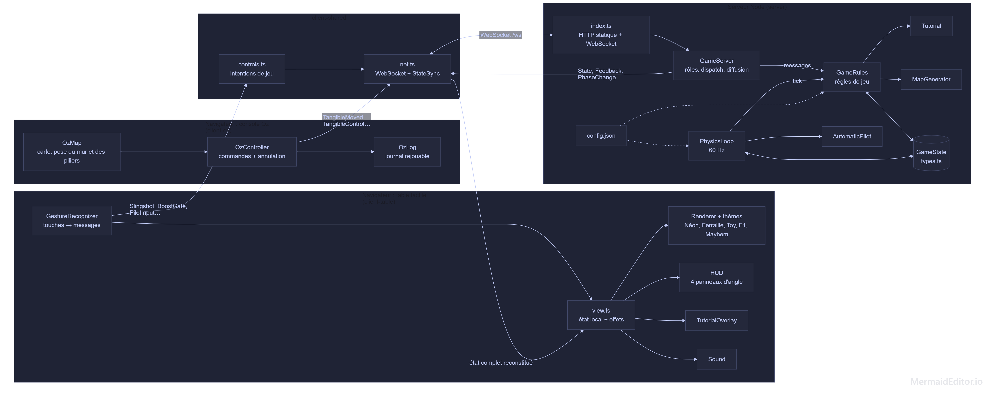
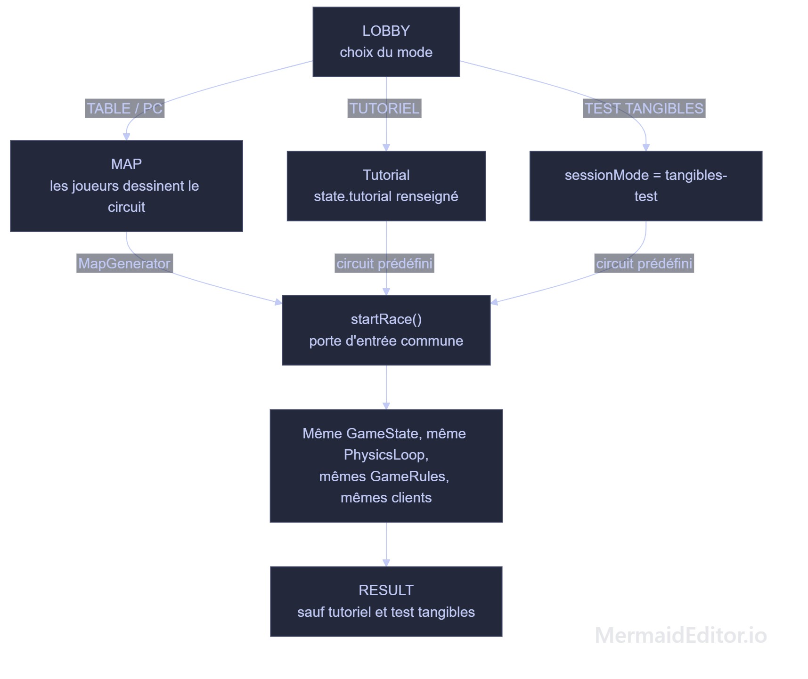

# Crashout Circuit : guide du code

Un résumé fichier par fichier du projet et un ordre de lecture conseillé.

## Vue d'ensemble

Le projet est un **serveur Node et deux clients navigateur**, écrits en TypeScript :

```
 Client table (tactile, canvas 1920×1080)  ──┐
                                             ├── WebSocket ──►  Serveur (autoritaire)
 Client Oz (console opérateur, un 2e PC)   ──┘                  physique 60 Hz, diffusion 30 Hz
```

- **Le serveur décide de tout.** Les clients envoient des *intentions* (un tracé, un geste, une valeur de direction) et affichent l'état qu'ils reçoivent.
- **La table n'envoie jamais de touches brutes.** `GestureRecognizer` les transforme d'abord en messages du protocole.
- **Oz remplace les capteurs des objets tangibles.** C'est un dispositif « magicien d'Oz » : un opérateur humain pose le mur et les piliers depuis une console.
- **Les phases de jeu** sont `LOBBY → MAP → READY → RACE ⇄ PAUSED → RESULT`.

## Schéma de l'architecture



Lecture : les trois couches ne se parlent que par messages. Le toucher devient une intention (`controls.ts`), part sur la WebSocket, est validé par `GameRules`, modifie le `GameState`, et l'état revient à tous les clients qui le dessinent.

## Les modes de jeu et ce qu'ils partagent

Tous les modes utilisent les mêmes composants. Ils ne se différencient que par quelques drapeaux dans l'état de jeu, et il n'existe pas de version séparée du jeu pour le tutoriel ou le test.



### Ce que tous les modes partagent

- **Le même état et le même serveur.** Un seul `GameState`, un seul `GameRules` et un seul `PhysicsLoop`. La physique, les collisions, la réparation à deux, les pickups, les tangibles et la logique du lance-pierre et du boost sont identiques partout.
- **La même porte d'entrée de la course.** TABLE/PC (après le dessin de la carte), TUTORIEL et TEST TANGIBLES appellent tous `startRace(track, …)` dans `GameRules.ts`. Elle place les voitures, crée les pickups, installe les trois tangibles et lance la phase.
- **Les mêmes clients.** `Renderer`, `HUD`, `GestureRecognizer`, la console Oz et le protocole WebSocket servent tous les modes. Les gestes à 3 doigts, la déformation de la piste et les pads de réparation sont les vrais, y compris dans le tutoriel.
- **Les mêmes retours serveur.** Le tutoriel ne réécrit aucune règle. `GameRules` lui transmet les événements réels (`pickup`, `itemArmed`, `stoneWarning`, `boostGate`, `trackDeformed`, `repairDone`…), et une étape se valide quand l'événement correspondant arrive.

### Ce qui change selon le mode

| | TABLE / PC | TUTORIEL | TEST TANGIBLES |
|---|---|---|---|
| Circuit | dessiné par les joueurs (phase MAP) | circuit prédéfini | circuit prédéfini |
| Départ | READY puis compte à rebours | course directe | READY puis ▶, B part 2 s après A |
| Drapeau | `mapMode` = table ou pc | `state.tutorial` renseigné | `sessionMode = 'tangibles-test'` |
| Pilotes | humains | humains | automatiques (`AutomaticPilot`) |
| Dégâts | réels | aucun, les chutes remettent la voiture sur la piste | réels |
| Fin de partie | tours ou chrono (`checkEnd`) | jamais | jamais |
| Objets | tirage aléatoire | objet imposé par étape, réapparition en 3 s | tirage aléatoire |

### En pratique

Chaque mode est un `if` posé sur un drapeau, répété à plusieurs endroits :

- Côté serveur : `if (s.tutorial)` dans `damage`, `fallOffTrack`, `checkEnd` et `afterMove`, `if (sessionMode === 'tangibles-test')` dans `PhysicsLoop`, `updateRepair` et `onPilotInput`.
- Côté client : le HUD, le `Renderer` et `main.ts` masquent quelques éléments selon ces mêmes drapeaux.

Le tutoriel est donc la vraie course avec des garde-fous et des étapes par-dessus, ce qui évite de maintenir deux jeux. Le revers est qu'une nouvelle règle doit penser à ces drapeaux. Par exemple, un nouveau type de dégât devra être mis à zéro dans le tutoriel.

## Dossier par dossier

### `server/` (logique de jeu, compilée avec `tsconfig.server.json`)

| Fichier | Rôle |
|---|---|
| `index.ts` | Point d'entrée HTTP et WebSocket. Il sert `dist/clients`, `/api/session` (adresses Oz) et `/api/oz-log`. |
| `GameServer.ts` | Registre des connexions, attribution des rôles (table ou oz) selon l'URL, distribution des messages et diffusion de l'état. |
| `PhysicsLoop.ts` | Simulation à pas fixe de 60 Hz : déplacement des véhicules, sorties de piste, puis appel des règles. |
| `GameRules.ts` | Le cœur du jeu, resté **façade** (une classe qui garde l'état et délègue). La logique vit dans `server/rules/`, un module par responsabilité : `trackCreation` (tracés de la carte), `raceStart` et `tutorialFlow` (départ, tutoriel), `sessionControl` (pause, retour à l'accueil, interrupteurs de test PC), `driving`, `armedItems` (POWER, lance-pierre, portails de boost), `repairDamage`, `tangiblesRules`, `trackDeformation`, `effectsExpiry`, `raceResult`. Chaque méthode de `GameRules` appelle la fonction du même nom du module. |
| `MapGenerator.ts` | Façade de la génération : transforme les deux tracés à main levée des joueurs en circuit fermé valide (`TrackGeometry`). Les étapes (nettoyage du tracé, fusion, géométrie, placement des éléments, validation, stratégies et secours) sont dans `server/trackGeneration/`. |
| `Tutorial.ts` | Tutoriel guidé, avec une progression indépendante par équipe, validée par de vrais événements de jeu. |
| `AutomaticPilot.ts` | Suiveur de ligne centrale utilisé par le mode « TEST TANGIBLES ». |
| `types.ts` | **Tous les types partagés** : `GameState`, `Phase`, `ClientMessage` et `ServerMessage`. Les clients l'importent aussi. Il réexporte `server/protocol/gameState.ts` (état) et `server/protocol/messages.ts` (protocole). |
| `config.ts` | Charge `config.json` (dégâts, vitesses, déformation, taille de la table) avec des valeurs par défaut. |
| `layout.ts` | Disposition de la table partagée avec le client : 4 panneaux d'angle, bouton des paramètres, dépôt neutre. |
| `geometry.ts` | Aides géométriques 2D : intersection de segments, point le plus proche de la ligne centrale, tir du lance-pierre. |
| `mapCreation.ts` | Règles des ancres P1/P2, partagées entre le dessin, la détection de touche et la validation serveur. |
| `tangibles.ts`, `tangibleGeometry.ts`, `tangibleTouch.ts` | Les trois tangibles fixes (un mur et deux piliers), la validation de leur pose, la géométrie de collision du mur et les contrôles de la pose tactile à deux contacts. |
| `boostGeometry.ts` | Placement et orientation du portail de boost à partir de deux contacts, y compris aux carrefours. |
| `trackPresentation.ts`, `audioHttp.ts` | Horloge commune de la révélation du circuit et de la roulette du départ ; service HTTP des fichiers audio. |
| `armedPickup.ts`, `raceSettings.ts` | Deux petits fichiers : la règle de réservation unique des objets armés, et l'échelle de vitesse de chaque difficulté. |

### `client-table/` (la table, en Canvas 2D)

- **Cœur**
  - `main.ts` : point d'entrée. Il ouvre la WebSocket, crée le moteur de rendu et le recognizer de gestes, puis appelle les modules de `app/` (taille du canvas, thèmes, réglages de course, outils de développement, audio, clavier, plein écran, messages du serveur, boucle de rendu).
  - `view.ts` : état local du client (effets, lance-pierre en cours de tir).
  - `GestureRecognizer.ts` : le cerveau multitouch, resté façade. Il suit jusqu'à 10 contacts ; chaque geste vit dans `gesture/` : lance-pierre (3 doigts, `slingGesture`), portail de boost (`bonusEvaluation`), déformation de la piste (`borderPullGesture`), dessin de la carte (`mapDrawing`), pose des tangibles (`placementTouch`), pilotage et réparation (`pilotControls`), aiguillage des contacts (`contactDown`, `contactRelease`).
  - `gestureTuning.ts` et `GestureLog.ts` : seuils tactiles réglables par l'URL (en développement) et journal des décisions du recognizer (F4, CSV).
  - `TutorialGestures.ts` : démonstrations animées des gestes du tutoriel.
  - `HUD.ts` : les quatre panneaux d'angle, chacun tourné vers son bord de table. Les pilotes ont la direction, les PV et la réparation ; les copilotes ont POWER et la réparation.
  - `TutorialOverlay.ts` : bandeaux du tutoriel pour chaque équipe.
  - `Sound.ts`, `AudioPlan.ts`, `AudioAssets.ts` : sons de la table (signaux synthétisés, extraits CC0 déclarés dans `audio/sources.json`), plan d'ambiance et de musique par thème.
  - `icons.ts` : pictogrammes canvas partagés.
- **Rendu**
  - `Renderer.ts` : moteur de rendu principal, resté façade (couches par thème et composition des écrans). Les écrans et surcouches sont dans `renderer/` (`screenOverlays`, `raceOverlays`, `mapCreationScreen`).
  - `themes.ts` : liste des thèmes et préférence locale. Les cinq thèmes sont Néon, Ferraille, Toy Circuit, F1 Classic et Mayhem.
  - `neon.ts`, `VisualMotion.ts` : petites aides partagées pour les textures, le bruit et l'historique de mouvement.
- **Décors propres à chaque thème**
  - Néon : `NeonTrack`, `NeonVehicles`, `NeonObjects`, `NeonEffects`, `VoidBackdrop`.
  - Ferraille : `ScrapTrack`, `ScrapBackdrop`, `ScrapMaterials`, `IndustrialMachinery`, `IndustrialMotion`, `IndustrialVapour`.
  - Toy : `ToyWorkshop`.
  - F1 : `F1Venue`, avec `StandSections` (tribunes).
  - Mayhem : `MayhemFestival`.
  - Commun : `CircuitTrack` et `CircuitMaterials` (la piste des thèmes F1, Toy et Mayhem), `ThemeWorld` (composition du décor), `SceneryLayout` (placement des éléments de décor sans chevauchement) et `RaceGrid` (cases de départ).
- **Retours des tangibles**
  - `TangibleTransitions.ts` : animations d'apparition, de déplacement et de retrait.
  - `TangibleTouchPreview.ts` : aperçu de la pose à deux contacts.
- `index.html` : la page de la table.

### `client-oz/` (console opérateur)

- `main.ts` : point d'entrée et câblage de la barre d'outils.
- `OzController.ts` : commandes de l'opérateur, avec état optimiste et annulation, indépendantes du DOM.
- `OzMap.ts` : la carte, restée façade, avec le placement manuel, le glisser et la rotation du mur. Le pointeur (`map/ozPointer.ts`) et le dessin (`map/ozDraw*.ts`) sont découpés dans `map/`.
- `OzLog.ts` : journal horodaté des événements, qui peut être rejoué.
- `ozView.ts` est un très petit fichier. `index.html` est la page de la console.

### `client-shared/` (utilisé par les deux clients)

- `net.ts` : connexion WebSocket, plus `StateSync`, qui reconstitue l'état complet parce que le serveur n'envoie les données lourdes de `track` que lorsqu'elles changent.
- `controls.ts` : interface d'« intentions de jeu » indépendante du périphérique (direction, POWER, geste). Un futur adaptateur mobile pourrait s'y brancher.
- `tangibleGeometry.ts` et `trackVisibility.ts` : géométrie partagée avec le serveur, et règle de visibilité de la piste.

### `scripts/` (tests, lancés avec `tsx`)

- `sling-balance.ts` : simulation d'équilibrage du lance-pierre (`npm run sim:sling`).
- `file-sizes.ts` : garde-fou de taille des fichiers (`npm run check:sizes`), avec `file-sizes.baseline.json` et son test.
- `acceptance.ts` : lance la grande suite de tests des règles serveur avec une horloge simulée, sans réseau. Les scénarios sont rangés par domaine dans `scripts/acceptance/` (`harness.ts` pour le banc commun, `scenarioActions.ts` pour les gestes de test partagés).
- `network-acceptance.ts` : tests WebSocket réels.
- `gestures.ts`, `gesture-reservations.ts`, `boost.ts`, `tangible-touch.ts`, `race-settings.ts`, `autopilot.ts` : un sujet chacun.
- `visuals.ts` : vérifications du rendu et de la disposition.
- `test-tangible-anims.ts` : vérifications des animations des tangibles.
- `npm run check` (types, taille des fichiers, acceptation, gestes, réseau, audio, création, session publique, pickups, build) est la commande de la CI. `npm run verify` lance tous les tests, plus la vérification des types et le build.

### Fichiers racine, documentation et prototype

- **Configuration :** `config.json` (toutes les valeurs réglables), `vite.config.ts` (deux pages, `/ws` et `/api` relayés vers le port 3000), `tsconfig.json` (clients et scripts), `tsconfig.server.json` (serveur), `package.json`.
- **`index.html` :** redirige vers `/client-table/`.
- **Documentation :** `README.md` est la meilleure description côté utilisateur. `context.md` est le registre de conception (identifiants R-xx, C-xx, etc.). `measures.md` sépare ce qui est testé automatiquement de ce qui doit encore être mesuré sur la vraie table. `docs/` couvre la direction artistique, les thèmes, le rendu néon, la lisibilité, la pose tactile et l'intégration de l'équipe. 
- **`.kiro/specs/` :** exigences, conception et liste de tâches d'origine.
- **`prototypes/piste-vivante/` :** l'ancien prototype de recherche en Next.js. `AGENTS.md` demande de le conserver comme historique et de ne jamais construire dedans.

## Ordre de lecture conseillé

1. **`README.md`** pour voir comment le jeu se joue.
2. **`server/types.ts`** pour apprendre le vocabulaire : `GameState`, `Phase` et les listes de messages.
3. **`server/index.ts` → `GameServer.ts` → `PhysicsLoop.ts`** pour suivre l'arrivée d'un message et le déroulement d'un tick.
4. **`GameRules.ts`**, à lire par fonctionnalité plutôt que de haut en bas. Prendre un flux à la fois : dessin de la carte, pickup et POWER, lance-pierre ou boost, réparation, tangibles.
5. **`client-shared/net.ts`, puis `client-table/main.ts`** pour voir comment l'état arrive à l'écran.
6. **`GestureRecognizer.ts` et `HUD.ts`** pour voir comment le toucher devient des messages.
7. **`Renderer.ts`**, puis les fichiers d'un thème si on travaille sur le visuel. Les fichiers de thème sont surtout de la décoration autonome.
8. **`client-oz/`** seulement si on travaille sur les tangibles ou la console.
9. **`scripts/acceptance.ts`** comme documentation vivante : chaque test montre le comportement attendu d'une règle.

Pour suivre une fonctionnalité, suivre un message de bout en bout : le chercher dans `types.ts`, trouver où `GestureRecognizer` ou `OzController` l'envoie, puis où `GameRules` le traite, et enfin comment `Renderer` dessine le résultat.

Commandes utiles :

```bash
npm run build && npm start
```

```bash
npm run verify
```


> Écrit d'après l'état de `main` au 29 octobre 2026, puis mis à jour le 16 novembre 2026 : les fichiers de plus de 500 lignes ont été découpés (issue #66). Les chemins d'import d'origine sont conservés : le fichier d'origine réexporte ou délègue. La règle de taille (cible 300 lignes, plafond 500) est contrôlée par `npm run check:sizes`.
